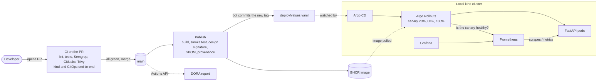

# CI/CD Showcase

[](https://github.com/Amukelani-AJ/cicd-showcase/actions/workflows/ci.yml)
[](https://github.com/Amukelani-AJ/cicd-showcase/actions/workflows/security.yml)
[](https://github.com/Amukelani-AJ/cicd-showcase/actions/workflows/publish.yml)
[](https://github.com/Amukelani-AJ/cicd-showcase/actions/workflows/gitops-e2e.yml)

A tiny FastAPI service with a complete delivery pipeline built around it: automated tests and security gates, signed container images, GitOps deployment on Kubernetes, canary releases that roll themselves back, and DORA metrics. It runs entirely for free, on one laptop.

The app is deliberately small. The pipeline is the project, and so are the incidents along the way, which are written up in [docs/LESSONS.md](docs/LESSONS.md).

## What this demonstrates

| Capability | What is built | Look at |
|---|---|---|
| Automated quality gates | ruff, pytest with an 80% gate (99% actual), a repo hygiene check, all on every PR | [ci.yml](.github/workflows/ci.yml) |
| Container hygiene | Multi-stage, non-root, health-checked image; smoke-tested before and after publishing | [Dockerfile](Dockerfile) |
| Supply-chain security | Gitleaks, Semgrep, Trivy (files and image), CycloneDX SBOM, keyless cosign signing, build provenance attestation, every Action pinned to a commit SHA and kept fresh by Dependabot | [security.yml](.github/workflows/security.yml), [publish.yml](.github/workflows/publish.yml) |
| Kubernetes packaging | A hardened Helm chart (read-only root filesystem, dropped capabilities, limits) proved on a fresh kind cluster in CI | [charts/](charts/cicd-showcase), [ci.yml](.github/workflows/ci.yml) |
| GitOps | Argo CD deploys whatever Git says; CI never holds cluster credentials; manual drift is reverted | [argocd/](argocd), [deploy/values.yaml](deploy/values.yaml), [gitops-e2e.yml](.github/workflows/gitops-e2e.yml) |
| Observability | Prometheus metrics from the app, a ServiceMonitor, a Grafana dashboard, all installed by Argo CD | [dashboard](charts/cicd-showcase/files/dashboard.json) |
| Progressive delivery | Argo Rollouts canary judged by Prometheus on the canary pods only; a bad release aborts itself | [CANARY_DEMO.md](docs/CANARY_DEMO.md) |
| Delivery metrics | The five current DORA metrics from the GitHub API, with the proxies called out honestly | [DORA.md](docs/DORA.md), [dora/](dora) |
| Engineering discipline | 16 logged decisions with options and trade-offs, an append-only worklog, attribution headers | [DECISIONS.md](docs/DECISIONS.md), [WORKLOG.md](WORKLOG.md) |

## How a change reaches the cluster



## Proof, with numbers

- **A bad release rolls itself back.** A release with `FAIL_RATE=0.6` measured a success rate of 0.4 to 0.57 on the canary pod, was aborted within about 45 seconds, and users kept getting 100% good responses. A good release was promoted in about three minutes with every measurement at 100%. Transcripts: [docs/CANARY_DEMO.md](docs/CANARY_DEMO.md).
- **The whole loop runs unattended.** Merge, publish, signed image, bot commit of the new tag, Argo CD sync, canary analysis, promotion. After the last feature PR merged, the cluster promoted the new image to 5 of 5 pods with no manual step.
- **The image is verifiable by anyone.** `gh attestation verify` and `cosign verify` pass from outside CI (commands in the [runbook](docs/RUNBOOK.md)).
- **Failures are documented, not hidden.** A frozen VM caused a false rollback, a registry throttled CI, my own workflow had a shell-injection pattern that Semgrep caught, and my clock turned out to be almost four minutes fast. What happened and what changed: [docs/LESSONS.md](docs/LESSONS.md).

## Try it

Needs Docker. The cluster parts also need [kind](https://kind.sigs.k8s.io/) and [Helm](https://helm.sh/) (`winget install Kubernetes.kind Helm.Helm`). The scripts are PowerShell, written and tested on Windows.

```powershell
# the service
docker build -t cicd-showcase:dev .
docker run --rm -p 8000:8000 cicd-showcase:dev        # http://localhost:8000/docs

# the same CI checks GitHub runs, in Docker
docker compose -f docker-compose.ci.yml --profile python run --rm ci-python

# the full platform: kind, Argo CD, Prometheus, Grafana, Argo Rollouts, and the app
./scripts/cluster.ps1 gitops                          # http://localhost:8088/version

# watch a good release get promoted and a bad one get rolled back
./scripts/demo-canary.ps1

# the DORA report for this repo
python -m dora --repo Amukelani-AJ/cicd-showcase      # build/dora/index.html
```

Everything else (UIs, credentials, verification commands, troubleshooting) is in the [runbook](docs/RUNBOOK.md).

## Documentation

| Document | What it is |
|---|---|
| [docs/RUNBOOK.md](docs/RUNBOOK.md) | Commands, ports, credentials, verification, troubleshooting |
| [docs/ARCHITECTURE.md](docs/ARCHITECTURE.md) | Components and which phase delivered each |
| [docs/DECISIONS.md](docs/DECISIONS.md) | 16 decisions: options considered, constraints, trade-offs |
| [docs/LESSONS.md](docs/LESSONS.md) | What went wrong, and what I would do differently |
| [docs/CANARY_DEMO.md](docs/CANARY_DEMO.md) | Real transcripts of the canary promoting and rolling back |
| [docs/DORA.md](docs/DORA.md) | How each DORA metric is measured and how far to trust it |
| [docs/API_DESIGN.md](docs/API_DESIGN.md) | The service's routes, metrics and failure injection |
| [docs/PLAN.md](docs/PLAN.md) | The phased plan and its status |

## Known limits

This is a demonstration on one machine, not a production platform. The main gaps, with the reasoning in [docs/LESSONS.md](docs/LESSONS.md): the cluster does not yet *refuse* unsigned images; canary rollbacks happen inside the cluster, so the DORA instability metrics are proxies; the canary path is proven by a script and a transcript rather than by CI; `main` has no branch protection; and there is no cloud deployment.

## How the work is run

Work happens on branches and lands through pull requests with every check green. Each change is logged in [WORKLOG.md](WORKLOG.md), code files carry cumulative attribution headers, and [scripts/validate-compliance.py](scripts/validate-compliance.py) enforces the hygiene rules in CI. The rules are in [CLAUDE.md](CLAUDE.md).
